# Code map

How information moves through `core_score`, file by file and then function by function.
Arrows are calls. Arrow labels name the data passed along. Every file writes its outputs
through `results.py` (`write_json`, `write_csv`, `write_jsonl`, `diagnostic`), which is
left off the diagrams to keep them readable.

Read the code in this order: `cli.py`, `pipeline.execute()`, then each file in `stages/`
in the order `execute()` calls them, then the helpers each one uses in `stages/utils/`.

## 1. Files

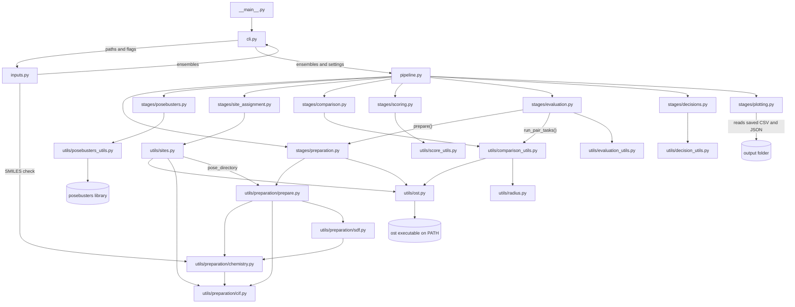

## 2. Data passed between stages

Every record is a plain dictionary. Each stage adds to it or derives a new list from it.

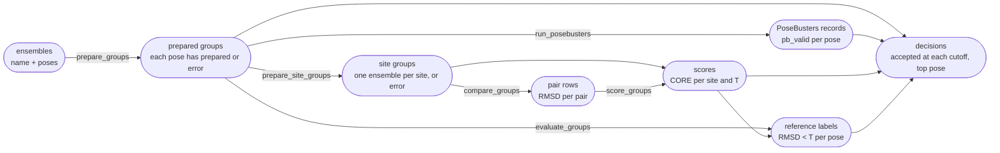

The record for one pose, as it grows:

| After | Adds | Key fields |
| --- | --- | --- |
| `load_inputs` | the pose | `ensemble`, `pose_id`, `path`, `smiles`, `ligand_chains`, `seed`, `sample`, optional `ligand_sdfs` and `confidence` |
| `prepare_groups` | `prepared` or `error` | `prepared.path`, `ligand_sdfs`, `copies`, `copy_records` (one per ligand copy: `residue`, `ost_sdf`, `pb_sdf`, `pb_error`, `provenance`, `centre`), `route`, `receptor` |
| `prepare_site_groups` | `site` on the group | each pose cut to one copy per site |
| `compare_groups` | one row per pair | `pose_i`, `pose_j`, `n_assigned`, `rmsd`, `bb_rmsd`, `lddt_lp`, `lddt_pli`, radius fields, `error` |
| `score_groups` | one row per site and T | `pose_count`, `threshold_angstrom`, `core_score`, `error` |
| `decide_groups` | one row per site, T and cutoff | `core_cutoff`, `likely_correct`, `top_pose`, `top_pose_correct`, `note` |

## 3. Functions, stage by stage

### 3.1 Command and inputs

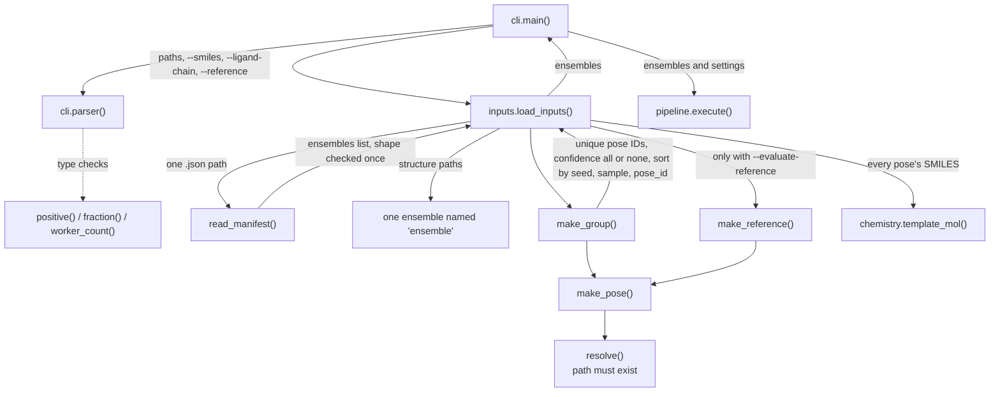

### 3.2 The run

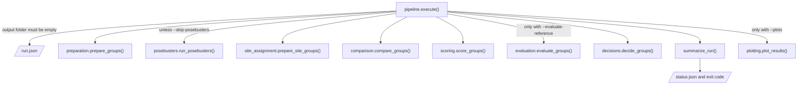

### 3.3 Preparation

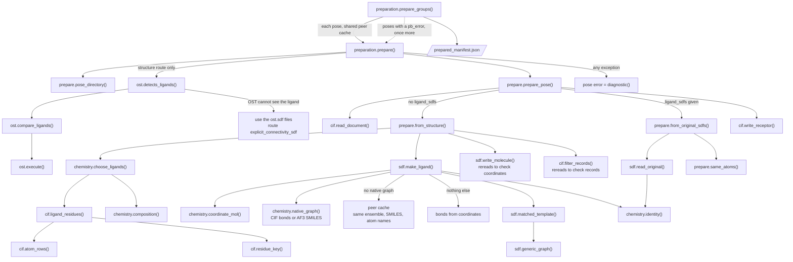

### 3.4 PoseBusters

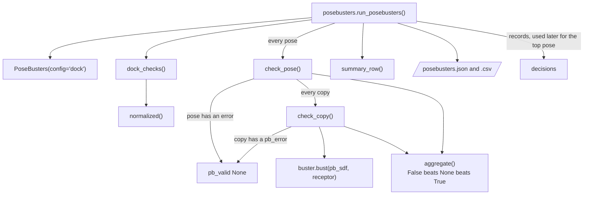

### 3.5 Site assignment

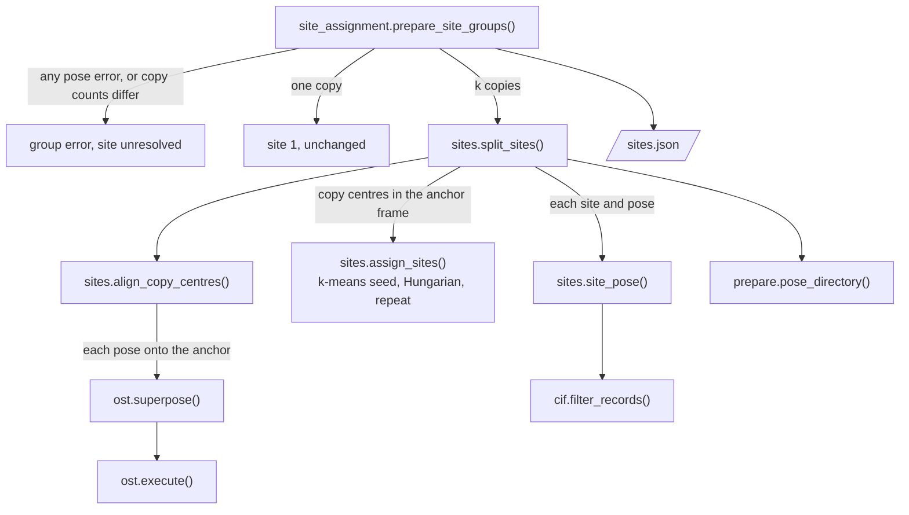

### 3.6 Comparison

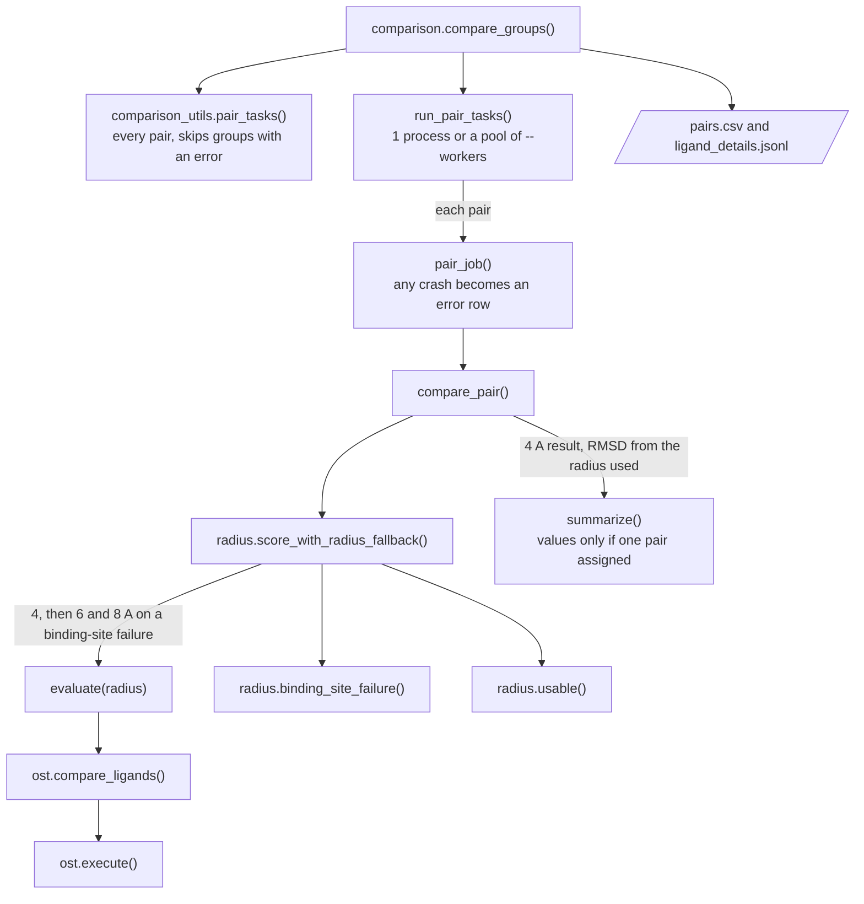

### 3.7 Scoring

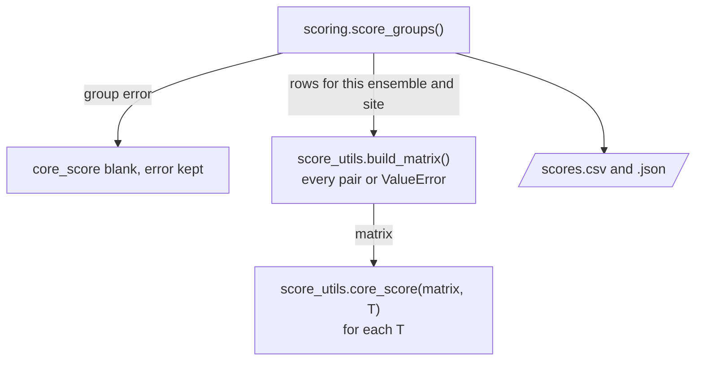

### 3.8 Reference evaluation (with `--evaluate-reference`)

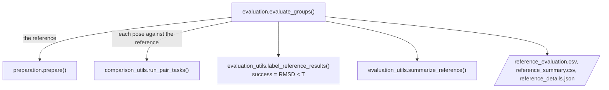

### 3.9 Decisions

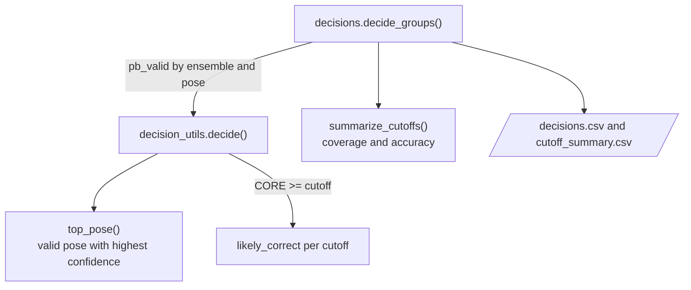

### 3.10 Plots (with `--plots`)

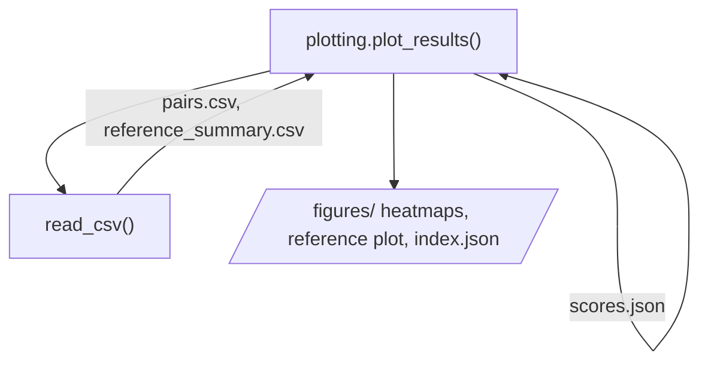

## 4. Every function

### `cli.py`
| Function | Does |
| --- | --- |
| `main(argv)` | Parses the command, loads inputs, runs `execute()`, prints counts. Returns 0, 1 if anything is incomplete, 2 for bad input. |
| `parser()` | Defines every flag. |
| `positive`, `fraction`, `worker_count` | Argument types for thresholds, cutoffs and workers. |

### `inputs.py`
| Function | Does |
| --- | --- |
| `load_inputs(inputs, ...)` | Turns one JSON path or a list of structures into ensembles. Checks every SMILES. Loads references only when evaluating. |
| `read_manifest(path)` | Reads the JSON and checks its shape once, with one error message. |
| `make_group(ensemble, ...)` | Builds an ensemble's poses, checks unique pose IDs and all-or-none confidences, sorts by `(seed, sample, pose_id)`. |
| `make_pose(record, ...)` | One pose record with settings filled from the ensemble and command line. |
| `make_reference(reference, ...)` | The reference as a pose record with `pose_id` "reference". |
| `resolve(base, path)` | Absolute path that must exist. |

### `pipeline.py`
| Function | Does |
| --- | --- |
| `execute(groups, output, ...)` | Runs every stage in order and writes `run.json` and `status.json`. |
| `summarize_run(...)` | Counts incomplete scores, failed pairs, blocked ensembles and unknown labels. |

### `results.py`
| Function | Does |
| --- | --- |
| `clean(value)` | Makes values JSON-safe. NaN and pandas NA become None. |
| `write_json`, `write_jsonl`, `write_csv` | Write output files. |
| `fingerprint(value)` | Stable hash, used for folder and figure names. |
| `diagnostic(stage, exc, ...)` | The failure record: stage, error, traceback, evidence. |

### `stages/preparation.py`
| Function | Does |
| --- | --- |
| `prepare_groups(groups, output)` | Prepares every pose, retries poses whose chemistry failed once the peer cache is full, writes `prepared_manifest.json`. |
| `prepare(pose, destination, ...)` | Prepares one pose and asks OST whether it sees the ligand. Returns the pose with `prepared`, or with `error`. Also used for references. |

### `stages/utils/preparation/prepare.py`
| Function | Does |
| --- | --- |
| `pose_directory(output, pose)` | `prepared/<hash>/` for a pose. |
| `prepare_pose(pose, destination, cache)` | Picks a route, then writes the receptor. Returns the prepared record. |
| `from_structure(...)` | Selects ligand residues, builds OST and PoseBusters SDFs per copy, writes the filtered structure. |
| `from_original_sdfs(...)` | Uses supplied SDFs and finds which structure residues they replace. |
| `same_atoms(rows, mol)` | Whether a residue holds the molecule's atoms at the same coordinates. |

### `stages/utils/preparation/chemistry.py`
| Function | Does |
| --- | --- |
| `template_mol(smiles)` | Heavy-atom molecule from SMILES. Raises if missing or invalid. |
| `heavy_atoms`, `atom_name`, `composition` | Small helpers on atom records. |
| `choose_ligands(doc, pose)` | Ligand residues picked by chain, residue number and SMILES composition. Raises on ambiguity, absence, mixed compositions or duplicate atom names. |
| `coordinate_mol(rows)` | Molecule with atoms and coordinates only. |
| `identity(mol)` | Canonical SMILES without stereo, for comparing chemistry. |
| `native_graph(doc, rows)` | Bonds from the structure's bond table or AF3's SMILES and atom names, if present. |

### `stages/utils/preparation/sdf.py`
| Function | Does |
| --- | --- |
| `make_ligand(doc, rows, smiles, cache, ensemble)` | The OST molecule and the PoseBusters molecule for one copy, with provenance, or the PoseBusters error. |
| `matched_template(template, observed)` | Puts the SMILES template's chemistry onto the observed atoms after an exact graph match. |
| `generic_graph(mol)` | Element-and-connectivity-only copy, for matching. |
| `write_molecule(mol, path)` | Writes an SDF and rereads it to check coordinates. |
| `read_original(path, smiles)` | Reads a supplied SDF and checks it matches the SMILES. |

### `stages/utils/preparation/cif.py`
| Function | Does |
| --- | --- |
| `read_document(path)` | Reads CIF, or converts PDB, requiring one model. |
| `atom_rows(doc)` | Atom records as dictionaries. |
| `residue_key(row)` | (chain, number, insertion code, residue name). |
| `ligand_residues(doc)` | Nonpolymer residues and their atoms. |
| `filter_records(doc, selected, destination)` | Writes the structure without unselected ligands and checks every kept record is unchanged. |
| `write_receptor(source, ligands, destination)` | Writes the PoseBusters receptor without the selected ligands. |

### `stages/utils/ost.py`
| Function | Does |
| --- | --- |
| `execute(arguments, timeout)` | Runs `ost ... -o file` and returns its JSON and the command, return code and output. |
| `compare_ligands(model, reference, timeout, radius)` | `compare-ligand-structures` for one pair. |
| `detects_ligands(prepared, timeout)` | Self-comparison: does OST find the ligand by itself? |
| `superpose(model_path, reference_path, timeout)` | `compare-structures --rigid-scores` transform. |
| `OSTError` | Error carrying the OST evidence. |

### `stages/posebusters.py` and `stages/utils/posebusters_utils.py`
| Function | Does |
| --- | --- |
| `run_posebusters(groups, output)` | Checks every pose and writes the results. Removes nothing. |
| `dock_checks(buster)` | Names of the dock config's binary checks. |
| `check_pose(buster, checks, pose)` | Validity of one pose across its copies. |
| `check_copy(buster, checks, copy, receptor)` | Runs PoseBusters on one copy. |
| `aggregate(values)` | False if any False, None if any unknown, else True. |
| `normalized(name)`, `summary_row(record)` | Check name format, and the one-row-per-pose CSV. |

### `stages/site_assignment.py` and `stages/utils/sites.py`
| Function | Does |
| --- | --- |
| `prepare_site_groups(groups, output)` | Blocks ensembles with failed poses or mismatched copy counts, passes one-copy ensembles through, splits the rest. |
| `split_sites(group, copies, output)` | One ensemble per site, and the report for `sites.json`. |
| `align_copy_centres(poses)` | Copy centres in the anchor pose's frame. |
| `assign_sites(points, k)` | Site label per copy, one copy per site per pose. |
| `site_pose(pose, copy, destination)` | The pose cut to one copy. |

### `stages/comparison.py` and `stages/utils/comparison_utils.py`, `radius.py`
| Function | Does |
| --- | --- |
| `compare_groups(groups, output, ...)` | Runs every pair and writes `pairs.csv` and `ligand_details.jsonl`. |
| `pair_tasks(groups)` | Every pair within each site ensemble. Skips groups with an error. |
| `run_pair_tasks(tasks, workers, ...)` | Runs tasks serially or in parallel, in order. |
| `pair_job(task, ...)` | One pair, with identity fields added and any crash turned into an error row. |
| `compare_pair(pose_i, pose_j, ...)` | OST at 4 Å with radius recovery, then the row and its details. |
| `summarize(result)` | Metrics only when exactly one ligand pair was assigned. |
| `score_with_radius_fallback(evaluate, radii)` | Tries 4 Å, then larger radii after binding-site failures. |
| `binding_site_failure(result)`, `usable(score)` | Recognise a binding-site reason, and a finite non-negative score. |

### `stages/scoring.py` and `stages/utils/score_utils.py`
| Function | Does |
| --- | --- |
| `score_groups(groups, rows, output, thresholds)` | CORE per site ensemble and T, or the reason it's missing. |
| `build_matrix(pose_ids, rows)` | Pairwise RMSD matrix. Raises unless every pair is usable. |
| `core_score(matrix, threshold)` | 1 − mean of min(closest other pose RMSD, T) / T. |

### `stages/evaluation.py` and `stages/utils/evaluation_utils.py`
| Function | Does |
| --- | --- |
| `evaluate_groups(groups, scores, output, ...)` | Prepares each reference, compares every pose with it, writes the reference files. |
| `label_reference_results(records, thresholds)` | Success means RMSD < T. Failed or ambiguous is unknown. |
| `summarize_reference(scores, labels)` | Each ensemble's CORE beside its fraction of poses correct. |

### `stages/decisions.py` and `stages/utils/decision_utils.py`
| Function | Does |
| --- | --- |
| `decide_groups(groups, scores, pb_records, labels, output, cutoffs)` | Writes `decisions.csv` and `cutoff_summary.csv`. |
| `top_pose(group, validity)` | The PoseBusters-valid pose with the highest confidence, or the reason there is none. |
| `decide(...)` | One row per site ensemble, T and cutoff: likely correct or not, the top pose, and whether it is correct. |
| `summarize_cutoffs(decisions)` | Per cutoff: how many accepted, coverage, and accuracy of the accepted top poses. |

### `stages/plotting.py`
| Function | Does |
| --- | --- |
| `plot_results(results, output)` | Heatmaps per site ensemble and the reference plot, from saved files only. |
| `read_csv(path)` | Rows of a saved CSV. |
