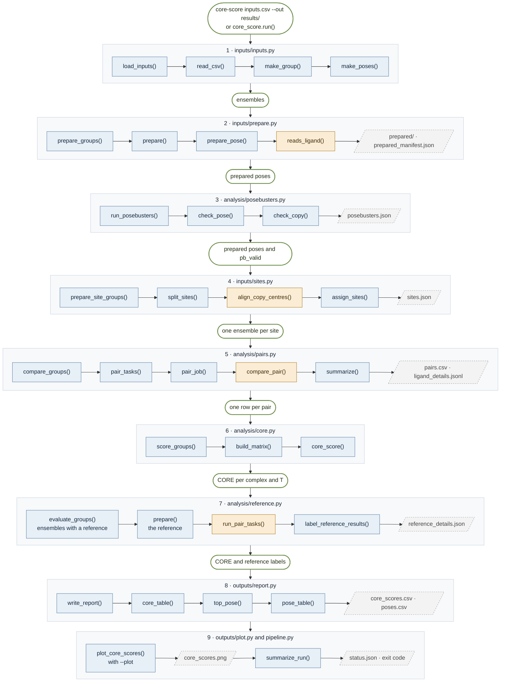
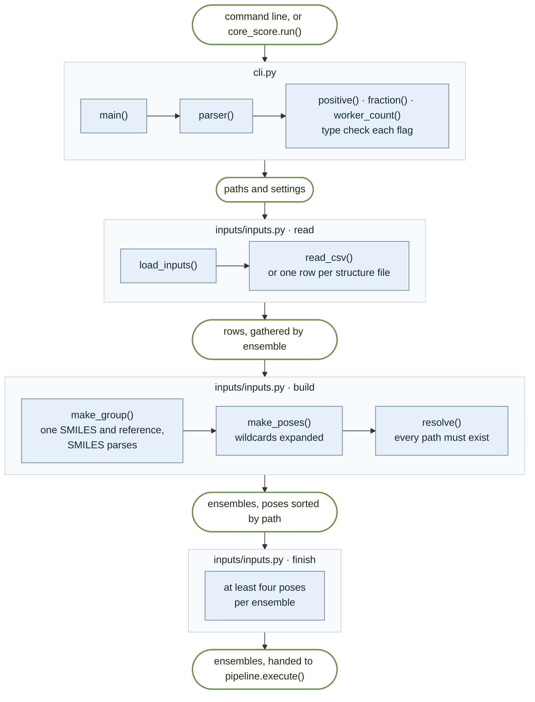
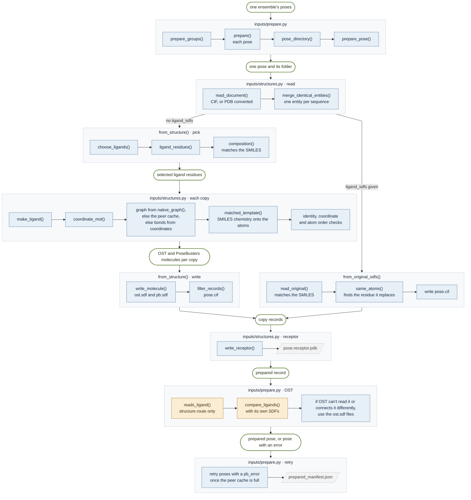
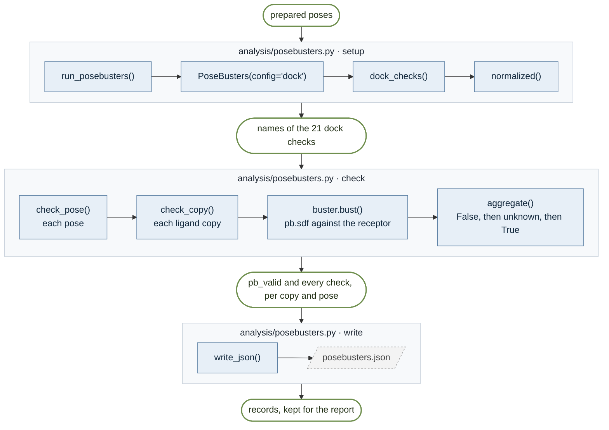
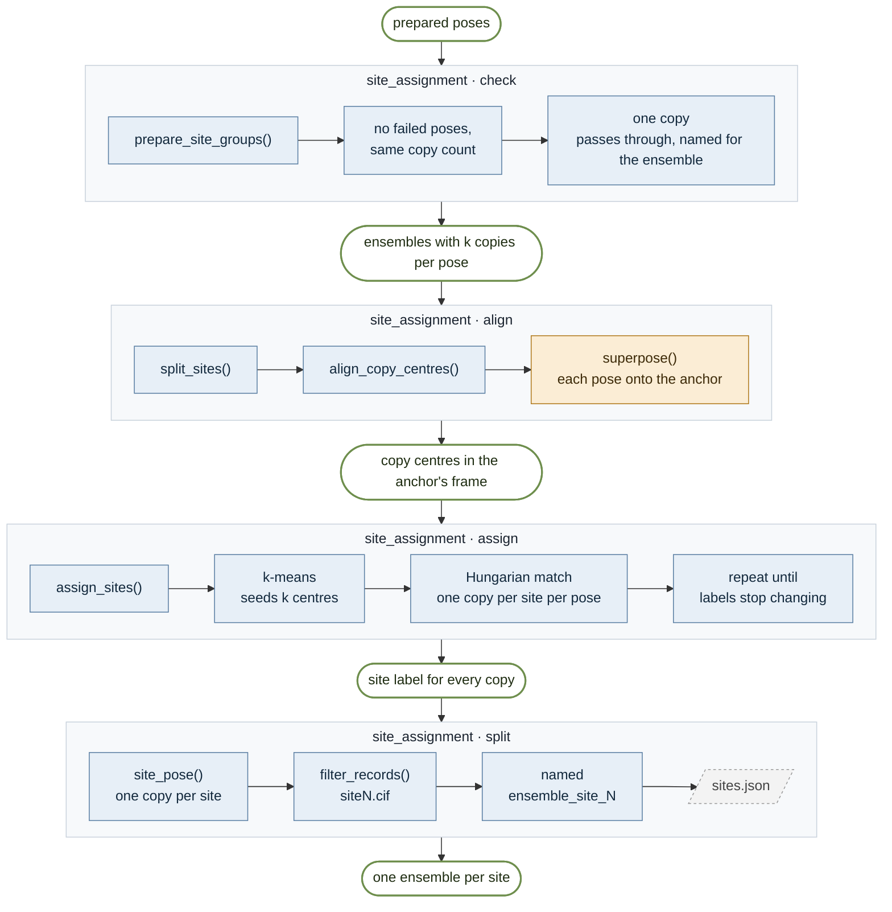
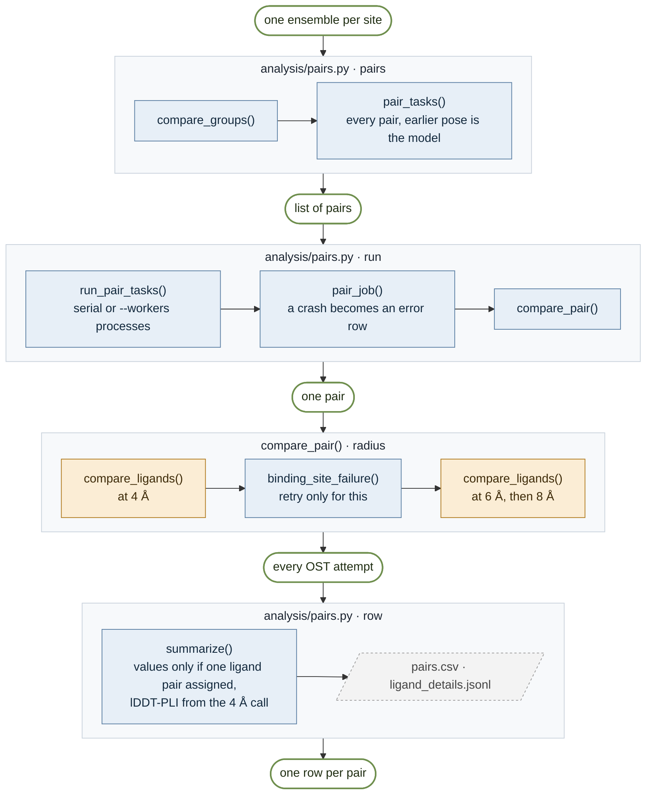
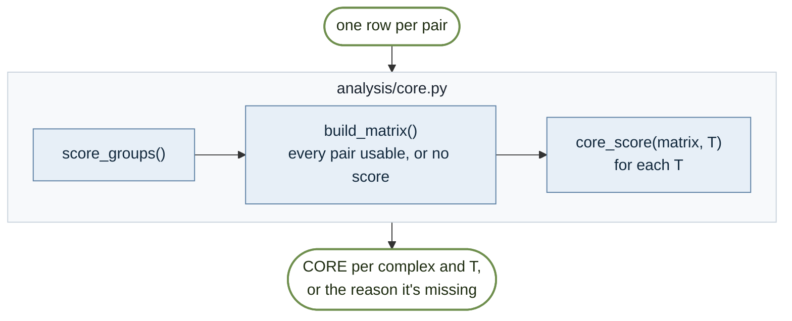
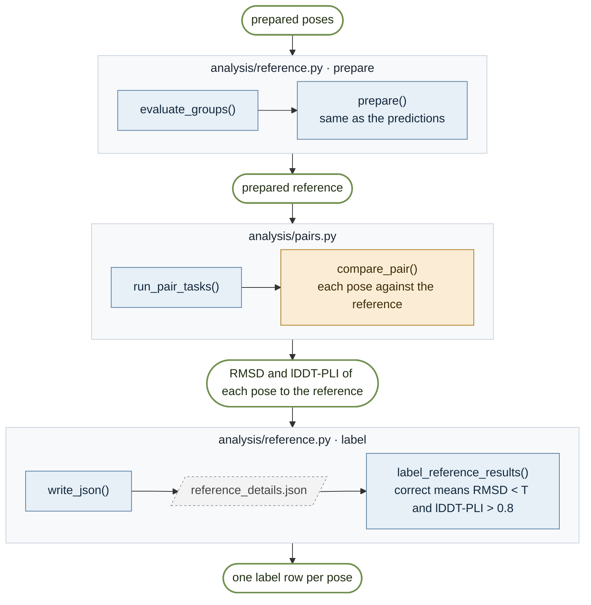
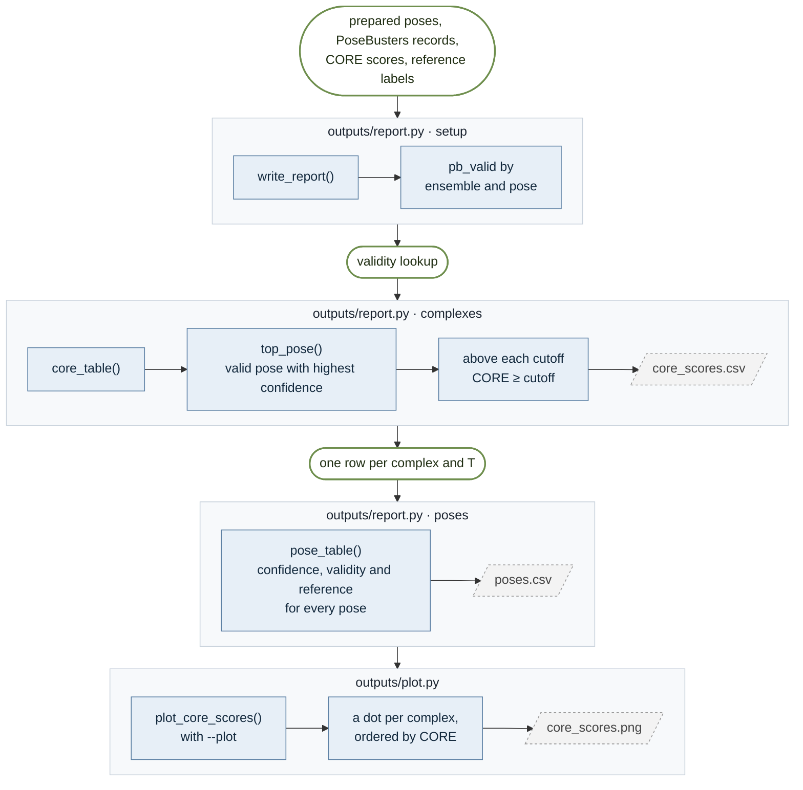

# Code map

How a run moves through `core_score`. Every diagram reads the same way:

- It runs top to bottom, one rung per step.
- Each rung lists its functions left to right, in the order they run.
- The rounded boxes between rungs are what's handed to the next step.
- Dashed boxes are files written. Amber functions call OpenStructure through `analysis/ost.py`.

`pipeline.execute()` runs the rungs of the first diagram in order. The result files go
in the output folder and everything behind them in `details/`.

## The whole run

## 1 · Inputs

`core-score-csv` writes the CSV beforehand, from a folder of predictions. It is its own
command and not part of a run. [Its section](#core-score-csv) lists its functions.

## 2 · Preparation

The functions in this stage come from `inputs/prepare.py` and the helpers in
`inputs/structures.py`.

## 3 · PoseBusters

## 4 · Site assignment

Only ensembles with several copies of the same ligand are split. Single-copy ensembles
pass straight through as site 1.

## 5 · Comparison

## 6 · Scoring

## 7 · Reference evaluation

Only for ensembles with a reference. Nothing here feeds back into CORE.

## 8 · Report

## Every check, and what happens when it fails

Input problems stop the run before anything is computed. After that, a failure is
recorded as an `error` on the pose or ensemble, later stages skip it, and the rest of the
run carries on.

| Where | Check | If it fails |
| --- | --- | --- |
| `cli.py` | Thresholds are finite and positive, cutoffs are between 0 and 1, workers is at least 1 | Usage error |
| `inputs/inputs.py` | The CSV has the columns `ensemble`, `smiles` and `poses`, filled on every row, and no unknown columns | Exit 2 |
| `inputs/inputs.py` | Every row of an ensemble gives the same SMILES and reference, and no structure is listed twice | Exit 2 |
| `inputs/inputs.py` | A row with a `confidence` or `ligand_sdf` names one structure | Exit 2 |
| `inputs/inputs.py` | `confidence` is given for every pose of an ensemble or for none | Exit 2 |
| `inputs/inputs.py` | Every structure, SDF and reference file exists, and every wildcard matches a file | Exit 2 |
| `inputs/inputs.py` | Every ensemble's SMILES parses and has heavy atoms | Exit 2 |
| `inputs/inputs.py` | Every ensemble has at least four poses | Exit 2 |
| `pipeline.py` | The output folder is new or empty | Exit 2 |
| `inputs/structures.py` | One structural model per file, with atom records | Pose error |
| `inputs/structures.py` | Requested chains exist, the ligand is present, selected copies share one composition, no duplicate atom names | Pose error |
| `inputs/structures.py` | Ligand coordinates are finite, native bond orders are supported | Pose error |
| `inputs/structures.py` | A native AF3 SMILES matches the supplied SMILES | Pose error |
| `inputs/structures.py` | The PoseBusters molecule matches the SMILES graph, sanitizes, and keeps identity, coordinates and atom order | `pb_error`, PoseBusters unknown, pose still scored |
| `inputs/structures.py` | Written SDFs reread with the same coordinates. Supplied SDFs hold one molecule with coordinates that matches the SMILES | Pose error |
| `inputs/structures.py` | The filtered structure rereads with every kept record unchanged | Pose error |
| `analysis/ost.py` | OST can read the prepared structure | Pose error |
| `analysis/posebusters.py` | Every dock check passes on every copy. Unknown is never a pass | `pb_valid` False or unknown |
| `inputs/sites.py` | No pose in the ensemble failed preparation | Ensemble blocked |
| `inputs/sites.py` | Every pose has the same number of ligand copies | Ensemble blocked |
| `analysis/ost.py`, `inputs/sites.py` | OST superposes each pose onto the anchor, and site assignment converges | Ensemble blocked |
| `analysis/pairs.py` | OST succeeds and assigns exactly one ligand pair | Pair error |
| `analysis/pairs.py` | Only binding-site failures are retried at a larger radius | Other failures stay failed |
| `analysis/core.py` | Every pair has a usable RMSD, and there are at least four poses | No CORE, reason saved |
| `analysis/reference.py` | The reference and the prediction both prepared, and the RMSD and lDDT-PLI are known | Label unknown (blank) |
| `outputs/report.py` | Confidences given, PoseBusters run, and at least one valid pose | No top pose, `note` says why |
| `outputs/plot.py` | matplotlib is installed, only with `--plot` | ImportError, after the files are written |
| `pipeline.py` | Nothing above left anything incomplete | Exit 1 |

## Every function

### `cli.py`
| Function | Does |
| --- | --- |
| `main(argv)` | Parses the command, calls `run()`, prints counts. Returns 0, 1 if anything is incomplete, 2 for bad input. |
| `parser()` | Defines every flag. |
| `positive`, `fraction`, `worker_count` | Argument types for thresholds, cutoffs and workers. |

### `inputs/inputs.py`
| Function | Does |
| --- | --- |
| `load_inputs(inputs, ...)` | Turns one CSV, or a list of structures, into ensembles of at least four poses. |
| `read_csv(path)` | Reads the CSV and checks its columns and required cells, with one error message. |
| `make_group(name, rows, base)` | One ensemble from its rows. Checks one SMILES and reference, that the SMILES parses, no structure twice and all-or-none confidences. Sorts poses by path. |
| `make_poses(name, row, base)` | The poses one row names, expanding a wildcard. Pose IDs are paths relative to the CSV. |
| `resolve(base, path)` | Absolute path that must exist. |

### `inputs/make_csv.py`, the `core-score-csv` command 
| Function | Does |
| --- | --- |
| `main(argv)` | Parses the command, writes the CSV, prints what it found. Returns 2 if anything is wrong, listing every problem. |
| `build_rows(predictions, smiles_csv, output, references)` | One row per pose of every ensemble folder, with confidence and reference where found. |
| `find_poses(folder)` | Structure files in the folder tree, each set of coordinates once, the deepest copy kept. |
| `confidence_file(structure)` | The model and confidence file written beside a structure, by `CONFIDENCE_FILES`. |
| `ligand_iptm(structure, smiles, rows, scores)` | Mean chain-pair ipTM between the ligand's chains and the receptor chains. |
| `af3_or_protenix`, `boltz`, `chai`, `openfold3` | Read each model's chain-pair ipTM. |
| `read_smiles(path)`, `relative(path, output)` | The ensemble,smiles CSV, and paths relative to the output CSV. |

### `pipeline.py`
| Function | Does |
| --- | --- |
| `run(inputs, out, ...)` | The Python entry point: `load_inputs()` then `execute()`, exactly as the command does. |
| `execute(groups, output, ...)` | Runs every stage in order and writes `details/run.json` and `details/status.json`. |
| `summarize_run(...)` | Counts incomplete scores, failed pairs, blocked ensembles and unknown reference labels. |

### `outputs/files.py`
| Function | Does |
| --- | --- |
| `clean(value)` | Makes values JSON-safe. NaN and pandas NA become None. |
| `write_json`, `write_jsonl`, `write_csv` | Write output files. |
| `fingerprint(value)` | Stable hash, used for folder names. |
| `diagnostic(stage, exc, ...)` | The failure record: stage, error, traceback, evidence. |
| `pose_directory(output, pose)` | `prepared/<hash>/` for a pose. |

### `analysis/ost.py`
| Function | Does |
| --- | --- |
| `execute(arguments, timeout)` | Runs `ost ... -o file` and returns its JSON and the command, return code and output. |
| `compare_ligands(model, reference, timeout, radius, lddt_pli)` | `compare-ligand-structures` for one pair, with lDDT-PLI only for references. |
| `reads_ligand(prepared, timeout)` | Does OST read every ligand copy from the structure, connected as in the package's SDFs? |
| `superpose(model_path, reference_path, timeout)` | `compare-structures --rigid-scores` transform. |
| `OSTError` | Error carrying the OST evidence. |

### `inputs/prepare.py`
| Function | Does |
| --- | --- |
| `prepare_groups(groups, output)` | Prepares every pose, retries poses whose chemistry failed once the peer cache is full, writes `prepared_manifest.json`. |
| `prepare(pose, destination, ...)` | Prepares one pose and asks OST whether it sees the ligand. Returns the pose with `prepared`, or with `error`. Also used for references. |
| `prepare_pose(pose, destination, cache)` | Picks a route, then writes the receptor. Returns the prepared record. |
| `from_structure(...)` | Selects ligand residues, builds OST and PoseBusters SDFs per copy, writes the filtered structure. |
| `from_original_sdfs(...)` | Uses supplied SDFs, finds which structure residues they replace and writes the structure. |
| `same_atoms(rows, mol)` | Whether a residue holds the molecule's atoms at the same coordinates. |

### `analysis/posebusters.py`
| Function | Does |
| --- | --- |
| `run_posebusters(groups, output)` | Checks every pose and writes `posebusters.json`. Removes nothing. |
| `dock_checks(buster)` | Names of the dock config's binary checks. |
| `normalized(name)` | Check names in lower case with underscores. |
| `aggregate(values)` | False if any False, None if any unknown, else True. |
| `check_pose(buster, checks, pose)` | Validity of one pose, and each check's result, across its copies. |
| `check_copy(buster, checks, copy, receptor)` | Runs PoseBusters on one copy. |

### `inputs/sites.py`
| Function | Does |
| --- | --- |
| `prepare_site_groups(groups, output)` | Blocks ensembles with failed poses or mismatched copy counts, passes one-copy ensembles through, splits the rest and names each site `<ensemble>_site_<n>`. |
| `split_sites(group, copies, output)` | One ensemble per site, and the report for `sites.json`. |
| `align_copy_centres(poses)` | Copy centres in the anchor pose's frame. |
| `assign_sites(points, k)` | Site label per copy, one copy per site per pose. |
| `site_pose(pose, copy, destination)` | The pose cut to one copy. |

### `analysis/pairs.py`
| Function | Does |
| --- | --- |
| `compare_groups(groups, output, ...)` | Runs every pair and writes `pairs.csv` and `ligand_details.jsonl`. |
| `pair_tasks(groups)` | Every pair within each site ensemble. Skips groups with an error. |
| `run_pair_tasks(tasks, workers, ...)` | Runs tasks serially or in parallel, in order. |
| `pair_job(task, ...)` | One pair, with identity fields added and any crash turned into an error row. |
| `compare_pair(pose_i, pose_j, ...)` | OST at 4 Å, then 6 and 8 Å after a binding-site failure. Returns the row and its details. |
| `summarize(result)` | Metrics only when exactly one ligand pair was assigned. |
| `usable(score)`, `binding_site_failure(result)` | A finite non-negative score, and a binding-site reason. |

### `analysis/core.py`
| Function | Does |
| --- | --- |
| `score_groups(groups, rows, thresholds)` | CORE per site ensemble and T, or the reason it's missing. |
| `build_matrix(pose_ids, rows)` | Pairwise RMSD matrix. Raises unless every pair is usable. |
| `core_score(matrix, threshold, neighbours)` | 1 − mean of min(RMSD, T) / T over each pose's three closest other poses. Raises with fewer than four poses. |

### `analysis/reference.py`
| Function | Does |
| --- | --- |
| `evaluate_groups(groups, output, thresholds, ...)` | For ensembles with a reference, prepares it, compares every pose with it, writes `reference_details.json`. Returns one label row per pose, in path order, for `poses.csv`. |
| `label_reference_results(records, thresholds)` | Correct means RMSD < T and lDDT-PLI > 0.8. Failed, ambiguous or missing either score is unknown. |
| `correct_column(threshold)` | The `poses.csv` column name, such as `correct_2A`. |

### `outputs/report.py`
| Function | Does |
| --- | --- |
| `write_report(groups, scores, pb_records, labels, output, cutoffs)` | Writes `core_scores.csv` and `poses.csv`. |
| `top_pose(group, validity)` | The PoseBusters-valid pose with the highest confidence, or the reason there is none. |
| `core_table(...)` | One row per complex and T: CORE, above each cutoff, pose counts, the top pose, and reference results. |
| `pose_table(groups, pb_records, labels, ranked)` | One row per pose: confidence, PoseBusters validity, and reference RMSD, lDDT-PLI and correctness. |
| `message(error)` | The one-line message of a diagnostic record. |

### `outputs/plot.py`
| Function | Does |
| --- | --- |
| `plot_core_scores(rows, output, cutoffs)` | `core_scores.png` per T: a dot per complex, ordered by CORE Score, with a line at each cutoff. Imports matplotlib only when called. |
| `style(matplotlib)` | The figure's type and hairline axes, using the first of `FONTS` installed. |
| `draw(axes, scores, threshold, cutoffs)` | The dots, the cutoff lines and their labels. |
| `dot_size(count)` | Smaller dots for bigger benchmarks. |

### `inputs/structures.py`
| Function | Does |
| --- | --- |
| `read_document(path)` | Reads CIF, or converts PDB, requiring one model. |
| `merge_identical_entities(doc)` | Gives polymer chains with the same sequence one entity, so OST can swap identical chains. Only entity IDs change. |
| `atom_rows(doc)` | Atom records as dictionaries. |
| `residue_key(row)` | (chain, number, insertion code, residue name). |
| `ligand_residues(doc)` | Nonpolymer residues and their atoms. |
| `filter_records(doc, selected, destination)` | Writes the structure without unselected ligands and checks every kept record is unchanged. |
| `write_receptor(source, ligands, destination)` | Writes the PoseBusters receptor without the selected ligands. |

| Function | Does |
| --- | --- |
| `template_mol(smiles)` | Heavy-atom molecule from SMILES. Raises if missing, invalid or without heavy atoms. |
| `heavy_atoms`, `atom_name`, `composition` | Small helpers on atom records. |
| `choose_ligands(doc, pose)` | Ligand residues picked by chain and SMILES composition. Raises on absence, mixed compositions or duplicate atom names. |
| `coordinate_mol(rows)` | Molecule with atoms and coordinates only. |
| `canonical_smiles(mol)` | Canonical SMILES without stereo, for comparing chemistry. |
| `native_graph(doc, rows)` | Bonds from the structure's bond table or AF3's SMILES and atom names, if present. |

| Function | Does |
| --- | --- |
| `make_ligand(doc, rows, smiles, cache, ensemble)` | The OST molecule and the PoseBusters molecule for one copy, with provenance, or the PoseBusters error. |
| `matched_template(template, observed)` | Puts the SMILES template's chemistry onto the observed atoms after an exact graph match. |
| `generic_graph(mol)` | Element-and-connectivity-only copy, for matching. |
| `write_molecule(mol, path)` | Writes an SDF and rereads it to check coordinates. |
| `read_original(path, smiles)` | Reads a supplied SDF and checks it matches the SMILES. |
